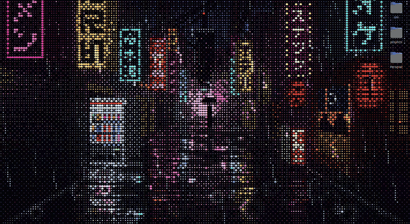

<p align="center">
  <picture>
    <source media="(prefers-color-scheme: dark)" srcset="docs/banner.dark.svg">
    
  </picture>
</p>

Use [ascii.rest](https://github.com/bas3line/ascii) pieces as live wallpapers in [Hidamari](https://github.com/jeffshee/hidamari), on Linux. This repo holds `asciiwall`, a command that turns any piece from ascii.rest into a wallpaper (including the pieces you make). `npm install` brings the library from ascii.rest's GitHub, and `asciiwall update` brings its new pieces as they come.

<p align="center">
  
</p>

```sh
asciiwall pick                    # the list, each piece playing beside it: enter sets the one you are on
asciiwall list                    # every piece by category, and your own; or asciiwall ls
asciiwall set tokyo-rain          # builds it and makes it the wallpaper
asciiwall set donut --fit 0.5 --fg f97316
asciiwall set big-text --opts '{"text":"hello"}'
asciiwall dev ocean               # one of your own: set again each time you save it
asciiwall build                   # rebuilds every wallpaper file, or the ones named
asciiwall update                  # the library's new pieces, and every wallpaper file again
asciiwall image photo.jpg         # a picture as a piece of your own, in my/
asciiwall --help                  # the commands and flags
```

## Install

It takes Linux, [Hidamari](https://flathub.org/apps/io.github.jeffshee.Hidamari) from Flathub or installed natively, and Node 20 or later. Open Hidamari once before the first `asciiwall set`, so it has a config to write the wallpaper into.

`npm install` takes the library from [ascii.rest's GitHub](https://github.com/bas3line/ascii) and builds it, rather than from npm, whose releases come later: new pieces are on GitHub first. Clone this, install, and put `asciiwall` on your `PATH`:

```sh
git clone https://github.com/sliaskonis/ascii-wallpapers
cd ascii-wallpapers && npm install
ln -s "$PWD/asciiwall.mjs" ~/.local/bin/asciiwall    # or any folder on your PATH
```

The still for GNOME's overview, [below](#the-overview-and-the-lock-screen), takes `ffmpeg`, `xwininfo` and `xwd` as well: on Ubuntu, `sudo apt install ffmpeg x11-utils x11-apps`. Without them the wallpaper plays all the same, and the overview keeps GNOME's background. `asciiwall image` reads pictures with `ffmpeg` too.

## Pick one

`asciiwall pick` opens the list in the terminal, your own pieces first and then the library's by category, with the piece you are on playing beside it. `*` marks the wallpaper as it is now, where the list opens.

| key | |
| --- | --- |
| `↑` `↓`, the mouse wheel | to the piece before or after |
| `PgUp` `PgDn`, `Home` `End` | a screen at a time, and to the list's ends |
| `←` `→` | to the category before or after |
| letters | keep the pieces with them in their name, or whose category starts with them: `rain`, `distro` |
| a click on a name | goes to it |
| `Enter` | makes the piece the wallpaper, and closes |
| `Esc` | clears what you typed, then closes without a change; `Ctrl+C` closes at once |

It takes the flags `set` does, and sets the piece with them: `asciiwall pick --fps 8`.

What plays is the piece as ascii.rest draws it in a terminal, so it is a likeness of the wallpaper and not the wallpaper: a scene is shrunk to fit beside the list, and every other piece keeps its size, showing its middle when the window is smaller. A bigger window shows more of it. The pieces also move at [ascii.rest](https://ascii.rest), where a piece's name is its name here.

## How it works

A wallpaper is one HTML file with the piece and its player inside, so it needs no network and no server. The files go in `~/Videos/Hidamari/ascii/`, the one folder Hidamari's Flatpak sandbox can read, one a piece: `tokyo-rain.html`.

`asciiwall set` writes the page's address into Hidamari's config and asks Hidamari to load it, as its own window does, so the choice is kept when you log in again. You can also pick a file by hand: in Hidamari, Web Page, then choose one from `~/Videos/Hidamari/ascii/`. Each file opens in a browser too, to look at one without changing the wallpaper.

## The overview and the lock screen

GNOME's overview, where you see your windows and workspaces, and its lock screen draw GNOME's own background, not Hidamari's window, so they can't show the wallpaper moving. For a video, Hidamari makes a still of it GNOME's background; for a page it doesn't, so `asciiwall set`, `pick` and `dev` do: once Hidamari shows the piece, a still of it becomes GNOME's background, blurred as Hidamari blurs its own.

Hidamari's settings drive it, as they do for a video: **Static wallpaper** turns it on and off, and **Blur radius** sets the blur, 0 for a sharp still. A change shows the next time you set a wallpaper. With Static wallpaper off, that puts back the background you had before. asciiwall keeps a note of that background, and the still, in `~/.local/share/asciiwall/`.

## Settings

| flag | |
| --- | --- |
| `--fit` | `cover` fills the screen and crops what overflows; `contain` shows all of it, edge to edge; a number is the share of `contain` it takes, `0.6` leaving a wide margin. Unasked, a scene fills the screen, and so does a piece made in the screen's shape; the rest take `0.8`. |
| `--fps` | frames a second, instead of the piece's own. Fewer is lighter on the processor. |
| `--bg` | the colour behind it, as `rrggbb`: the piece's own ground by default |
| `--fg` | the ink of a piece with no colours of its own, as `rrggbb` |
| `--opts` | the piece's options, as JSON. Their names and defaults are `meta.options` in [the piece's source](https://github.com/bas3line/ascii/tree/main/src/pieces), `src/pieces/<name>.ts`. |

They ride on the page's address, after a `?`, so a file picked by hand plays with the defaults.

## Make your own

A piece of your own is a `.ts`, `.js` or `.mjs` file in `my/`; its name is the file's. Three are there to start from:

| file | what it shows |
| --- | --- |
| [my/ocean.ts](my/ocean.ts) | a recipe from the kit, in one line |
| [my/northern-clock.ts](my/northern-clock.ts) | recipes put together: a clock that shows your time, under northern lights |
| [my/ripples.ts](my/ripples.ts) | a piece from nothing but the contract, with no kit: a function from the time to rows of characters |

Copy one, give it a name, and play it as you write it:

```sh
cp my/ocean.ts my/harbour.ts
asciiwall dev harbour
```

Each save shows on the desktop. A file that does not build leaves the last wallpaper up and says why in the terminal; a piece that throws says why on the wallpaper.

Sizes: a character is twice as tall as it is wide, so **192 by 54** is the shape of a 16:9 screen, ten pixels a column at 1920 across. 160 by 45 gives larger characters, 240 by 68 smaller ones. A kit look takes its size with `.size(192, 54)`, up to 320 by 120.

Where to read on:

- [the kit](https://ascii.rest/docs/kit/): looks, motions, widgets, 3D shapes, particles, images and the rest, each with examples
- [the kit's examples](https://github.com/bas3line/ascii/tree/main/examples/kit): small files, one idea each. They import from the repo's source; here, import the same names from `ascii.rest/kit`, `banner()` from `ascii.rest/banner` and library pieces from `ascii.rest/pieces`.
- [the library's pieces](https://github.com/bas3line/ascii/tree/main/src/pieces): the source of every one. To change one, copy it into `my/`: a file there is used before a library piece of the same name.
- [ascii.rest/make](https://ascii.rest/make/) turns a picture or a logo of yours into a piece file, in the browser.

The library's own terminal player, `npx ascii.rest play my/ocean.ts --watch`, needs Node 22.18 or later to run a `.ts` file; `asciiwall` builds it first, so it runs on Node 20.

### From a picture

`asciiwall image` makes a piece of your own from a picture: PNG, JPEG, WebP, GIF, AVIF, JPEG XL, TIFF, BMP, SVG or anything else `ffmpeg` reads.

```sh
asciiwall image ~/Pictures/harbour.jpg            # writes my/harbour.ts
asciiwall set harbour
asciiwall image ~/Downloads/page.png panel --invert --blur 1.5
```

The picture is softened first, so hatching, screentone and noise don't average out to a flat grey. Each character is then picked by the picture's tone there, denser where it is brighter, or is a stroke `| / - \` where the outline of a shape runs through it; its colour is the nearest of the picture's few colours, or a grey. The flags in `asciiwall --help` change how:

| flag | what it changes |
| --- | --- |
| `--cols 320` | detail: more characters across, each smaller. 240 by default |
| `--blur 1.5` | softening: more for drawings and scans, 0 for the finest detail. 0.75 by default |
| `--edges 12` | outline strokes, as a percent of the characters. 7 by default, 0 for none |
| `--colors 3` | how many colours, 1 for greys. Unasked: 6, or greys for a picture with hardly any colour |
| `--invert` | a negative, for a dark drawing on a light page, such as a manga page |

To try settings with the result on your desktop, run `asciiwall dev harbour` in one terminal and `asciiwall image ~/Pictures/harbour.jpg --force --blur 2` and the like in another: each run shows as it is written.

The piece is a still. Its code is at the top of the file and the picture at the bottom, so you can change it as you would any piece of yours. To make it move, change each character's tone by the time; the file shows how, with a band of light to uncomment. The file holds the picture, so if the picture is someone else's art, keep the file out of git with `echo my/harbour.ts >> .git/info/exclude`.

## Updating the library

```sh
asciiwall update
```

It brings the library's newest commit from GitHub, says which pieces are new, and writes every wallpaper file again with them. `package-lock.json` pins the commit, so a plain `npm install` keeps the one you have, and the library changes only when you ask.

To read the library's source beside you, or change it, clone it and use the clone in place of GitHub's, until the next `npm install`:

```sh
git clone https://github.com/bas3line/ascii ../ascii
cd ../ascii && npm install && cd -          # npm install builds it
npm install --no-save ../ascii
```

`asciiwall update` then leaves it to you: `git pull && npm install` in the clone, then `asciiwall build`.

## Uninstall

With **Static wallpaper** on, GNOME's background is a still in `~/.local/share/asciiwall/`, so put your own back before that folder goes: turn Static wallpaper off in Hidamari, and with Hidamari running, set any piece once.

```sh
asciiwall set tokyo-rain      # with Static wallpaper off, the background you had before is back
```

Then choose another wallpaper in Hidamari, or close it, and remove asciiwall and what it made:

```sh
rm ~/.local/bin/asciiwall                                 # or wherever you linked it
rm -r ~/Videos/Hidamari/ascii ~/.local/share/asciiwall
rm -r ascii-wallpapers                                    # this repo's clone
```

## Credits

The pieces, the kit and the player that draws them are [ascii.rest](https://github.com/bas3line/ascii), by bas3line, MIT licensed; each wallpaper file says so at its top.

asciiwall itself is MIT licensed too: see [LICENSE](LICENSE).
